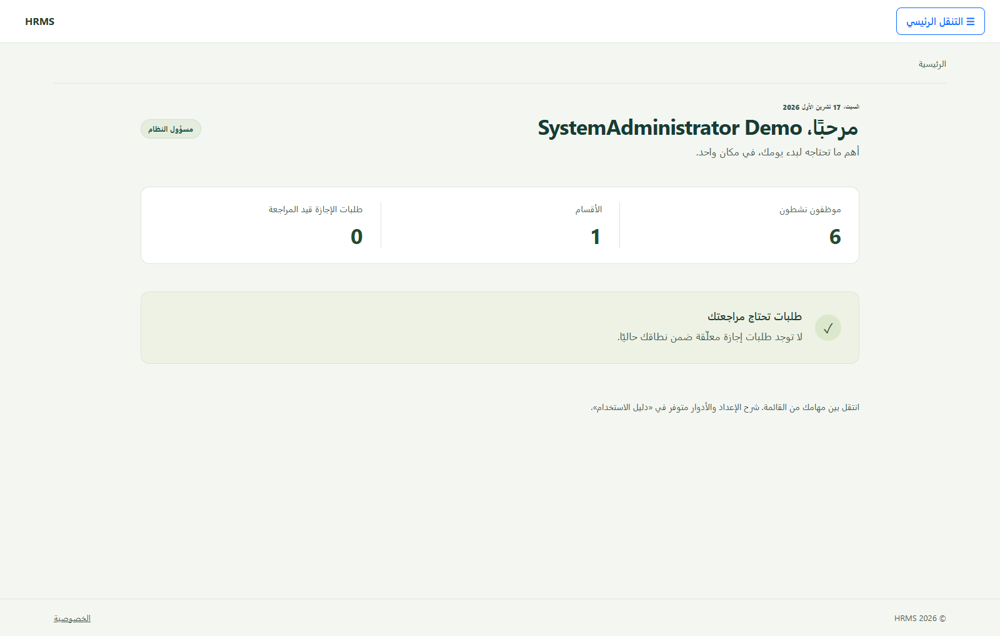
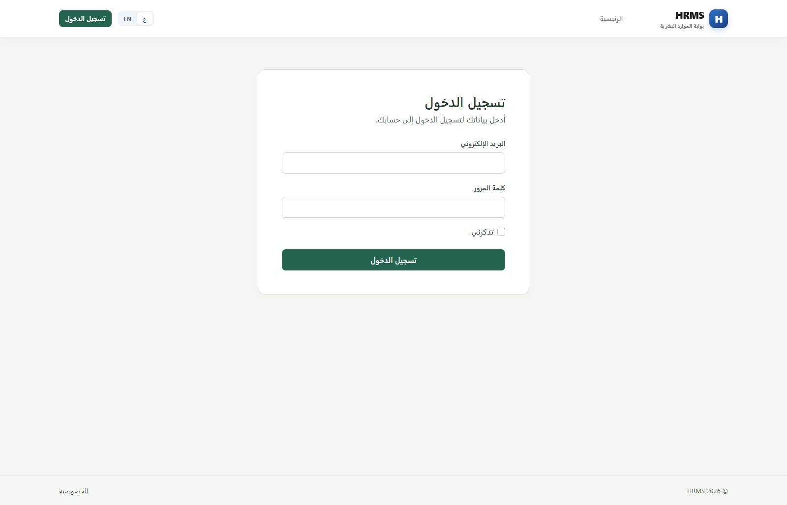
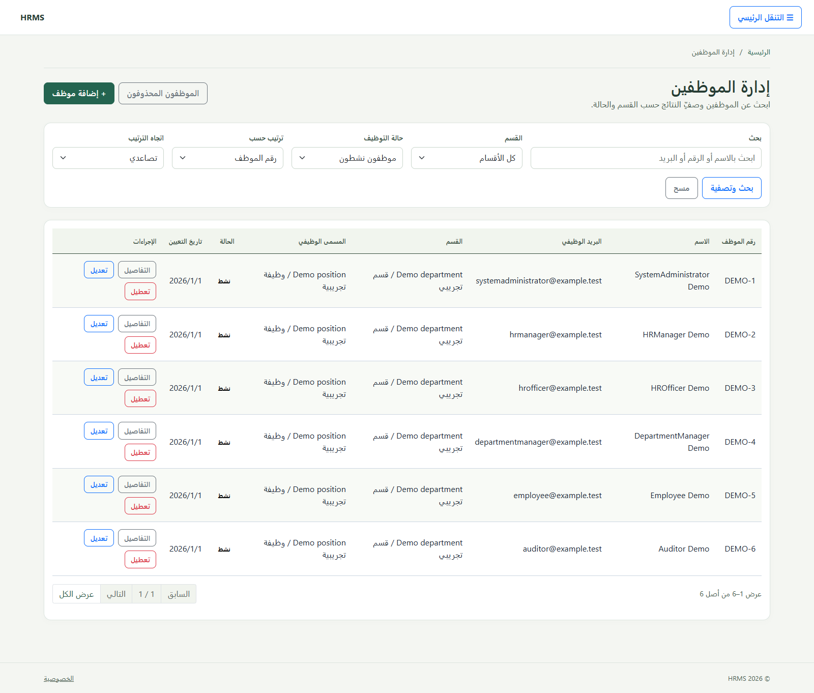
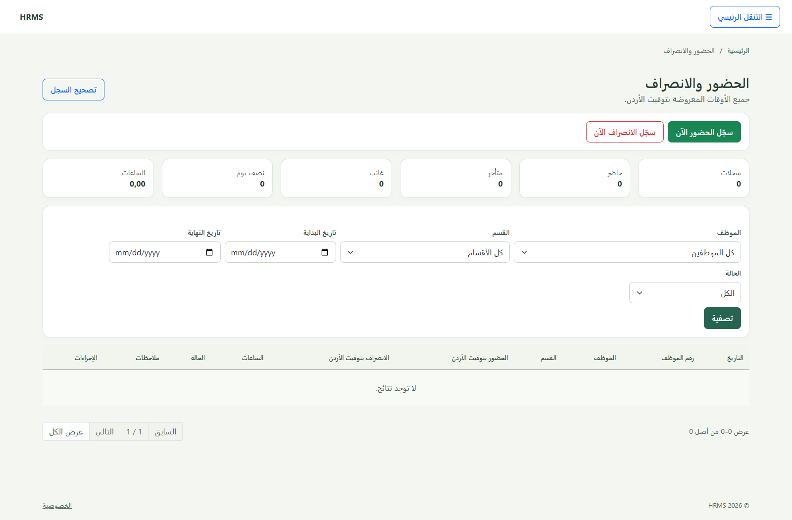

# HRMS | نظام إدارة الموارد البشرية

[English](README.md) | **العربية**

تطبيق لإدارة عمليات الموارد البشرية مبني على **ASP.NET Core MVC** و**Entity Framework Core** و**SQL Server**. يدعم العربية والإنجليزية، واتجاهي RTL وLTR.



## لقطات من النظام

| تسجيل الدخول | إدارة الموظفين |
|---|---|
|  |  |



> الصور ملتقطة من نسخة عرض محلية ببيانات تجريبية، ولا تتضمن بيانات أشخاص حقيقية.

## الوظائف

- ملفات الموظفين ودورة عملهم، الأقسام والمسميات الوظيفية.
- تسجيل الحضور والانصراف لعدة فترات مكتملة في اليوم، وتصحيح السجلات بالصلاحيات مع سجل تدقيق.
- إجازات سنوية ومرضية وبدون راتب بالتواريخ فقط، مع الأرصدة والمراجعة والاعتماد.
- لوحة المعلومات والتقارير وسجل التدقيق، مع تنزيل PDF وإكسل وفق الفلاتر والصلاحيات.
- ستة أدوار وصلاحيات، وواجهات عربية وإنجليزية متجاوبة.
- واجهات MVC وواجهات API موثقة عبر Swagger في بيئة التطوير.

## التقارير والإجازات

1. افتح التقرير، وحدد الفلاتر والترتيب، ثم طبّقها.
2. اضغط **تنزيل PDF** أو **تنزيل إكسل**. الملف يشمل جميع النتائج المطابقة ضمن صلاحياتك، وليس ستة صفوف الصفحة الحالية فقط.
3. الموظف ينزّل طلباته وأرصدته من **تقرير إجازاتي**، ومدير القسم يصدّر نطاق قسمه فقط.

أنواع الإجازات ثابتة: **سنوية، مرضية، وبدون راتب**. الطلب يحتوي تاريخ البداية والنهاية والسبب، دون حقول ساعة أو مغادرات. من **الإجازات ← أنواع الإجازات** يستطيع مسؤول النظام ومدير الموارد البشرية تعديل بدل السنوية والمرضية أو تفعيل النوع وتعطيله. البدل الأولي ١٤ يومًا لكل منهما، مع حفظ القيم الموجودة في القاعدة. الأنواع القديمة تعطّلت دون حذف طلباتها.

إنشاء PDF يدعم العربية والإنجليزية ويستخدم متصفحًا محليًا على الخادم. اضبط `ReportExport__BrowserPath` إن كان المتصفح بمسار آخر. إكسل ملف `.xlsx` فعلي. راجع [تفاصيل تحديث المدرب وإعداد التصدير](docs/TRAINER_UPDATE_2026_10_19_AR.md) للسياسات التدريبية والحدود.

## المتطلبات

- .NET SDK 8 أو أحدث مع runtime لـ .NET 8.
- SQL Server 2019 أو أحدث؛ LocalDB مناسب للتطوير على Windows.
- Chrome أو Edge على خادم التطبيق لإنشاء PDF؛ وChrome لاختبارات المتصفح. تصدير إكسل لا يحتاج Microsoft Office.

يستهدف الحل .NET 8 ويستخدم ASP.NET Core وEF Core وIdentity بإصدار 8.0.31. راجع [ملاحظات التحقق والتوافق](docs/VERIFICATION.md) و[متطلبات القبول والفجوات](docs/ACCEPTANCE_AR.md) قبل النشر.

## التشغيل محليًا

من مجلد المشروع في PowerShell:

```powershell
dotnet tool restore
dotnet restore HRMS.sln
if (!(Test-Path .\HRMS\appsettings.Development.json)) {
    Copy-Item .\HRMS\appsettings.Development.example.json .\HRMS\appsettings.Development.json
}
$env:ASPNETCORE_ENVIRONMENT = "Development"
dotnet ef database update --project HRMS.Infrastructure --startup-project HRMS
dotnet run --project HRMS -- --seed-reference-data
dotnet run --project HRMS
```

ملف المثال يضبط اتصال LocalDB باسم `HRMSnew` ولا يحتوي كلمات مرور. عدّل الاتصال محليًا في `appsettings.Development.json`، أو مرره بمتغير البيئة `ConnectionStrings__HRMS`. لا تضع بيانات اعتماد قاعدة بيانات حقيقية في ملفات المشروع.

لإنشاء أول حساب، فعّل الإعداد المحلي فقط على قاعدة تطوير فارغة:

```powershell
dotnet user-secrets set "Identity:AllowInitialAdministratorSetup" "true" --project .\HRMS\HRMS.csproj
```

ثم افتح `/Account/Setup` وأنشئ الحساب، وبعدها أوقف الخيار:

```powershell
dotnet user-secrets set "Identity:AllowInitialAdministratorSetup" "false" --project .\HRMS\HRMS.csproj
```

يُخزّن ASP.NET Core User Secrets الإعدادات محليًا خارج المستودع. لا تفعّل إعداد الحساب الأول على نشر عام. لتجربة بيانات العرض على قاعدة تطوير فارغة، راجع [دليل إعداد البيانات التجريبية واستعادة حساب الأدمن](docs/DELIVERY_AR.md) و[دليل التشغيل](docs/USER_WALKTHROUGH_AR.md).

## قاعدة البيانات

تُحفظ مخططات EF Core في `HRMS.Infrastructure/Persistence/Migrations`. بعد ضبط `ConnectionStrings:HRMS`، طبّقها بالأمر أعلاه. للاطلاع على مراجعة ما قبل الترحيل والنسخ الاحتياطي راجع [دليل قاعدة البيانات](docs/DATABASE.md). لا تشغّل بيانات العرض أو اختبارات SQL على قاعدة إنتاج.

## البناء والاختبارات

```powershell
dotnet build HRMS.sln
dotnet test HRMS.sln
```

تعمل اختبارات الوحدة والمعمارية وHTTP دون إعداد إضافي. تتجاوز أداة الاختبار سيناريوهات SQL والمتصفح إذا لم تتوفر متطلباتها؛ التجاوز لا يثبت نجاح هذه السيناريوهات. اختبارات SQL والمتصفح تحتاج اتصال SQL Server محليًا بصلاحية إنشاء قواعد مؤقتة:

```powershell
$env:HRMS_TEST_SQLSERVER = "Server=(localdb)\MSSQLLocalDB;Integrated Security=True;TrustServerCertificate=True"
dotnet test HRMS.sln
Remove-Item Env:HRMS_TEST_SQLSERVER
```

تستخدم اختبارات قاعدة البيانات قواعد مؤقتة بأسماء `HRMS_Test_<guid>` وتحذفها بعد الاختبار. راجع [خطوات التحقق](docs/VERIFICATION.md) للتفاصيل.

آخر تحقق كامل بتاريخ ١٩ تشرين الأول ٢٠٢٦: **١٠٣ ناجحًا، صفر فشل، صفر تجاوز**: ٥٠ للوحدات، و٧ للمعمارية، و٤٦ للتكامل وSQL وHTTP والمتصفح. لإعادة التحقق من نسخة النشر مع SQL Server وChrome:

```powershell
powershell -NoProfile -ExecutionPolicy Bypass -File scripts/verify-published.ps1
```

## بنية الحل

| المشروع | المسؤولية |
|---|---|
| `HRMS` | تطبيق الويب وواجهات MVC وAPI |
| `HRMS.Application` | خدمات الموارد البشرية وقواعد الاستخدام |
| `HRMS.Domain` | كيانات المجال |
| `HRMS.Infrastructure` | EF Core وSQL Server وIdentity والتكاملات |
| `tests` | اختبارات الوحدة والتكامل والمعمارية والمتصفح |

## الوثائق

- [دليل المستخدم العربي](docs/HRMS_USER_GUIDE_AR.md)
- [دليل التثبيت والتشغيل التفصيلي](docs/USER_WALKTHROUGH_AR.md)
- [المعمارية](docs/ARCHITECTURE.md) و[الواجهات البرمجية](docs/API.md)
- [النشر](docs/DEPLOYMENT.md) و[قاعدة البيانات](docs/DATABASE.md)
- [الصلاحيات والأدوار](docs/ROLES_AND_ACCESS_AR.md)
- [نتائج التحقق](docs/VERIFICATION.md) و[متطلبات القبول](docs/ACCEPTANCE_AR.md)
