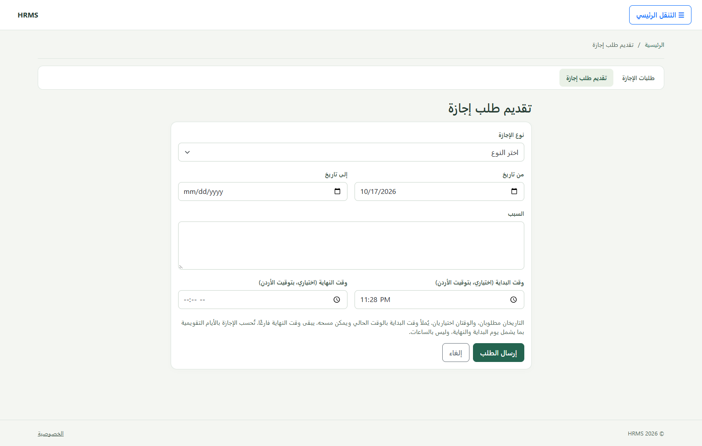
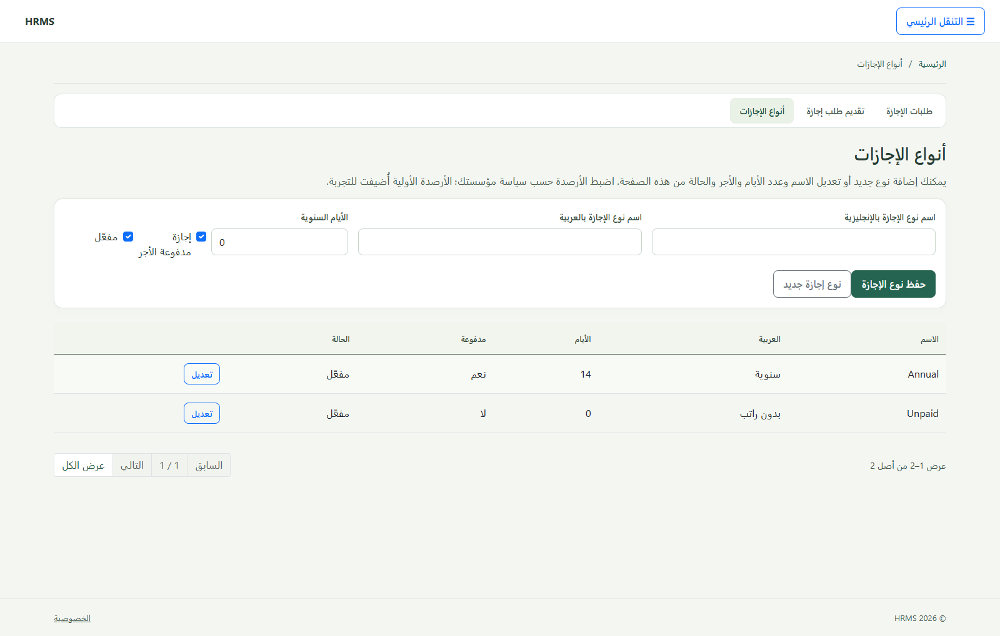

# HRMS | Human Resources Management System

**English** | [العربية](README.ar.md)

HRMS is an ASP.NET Core MVC application for employee records, attendance, leave, reporting, and audit. It uses Entity Framework Core and SQL Server, supports Arabic and English (RTL and LTR), and includes six application roles.


## Screenshots

| Sign in | Employee management |
|---|---|
|  |  |

| Attendance | Leave request |
|---|---|
|  |  |



> Screenshots use local demonstration data and contain no real employee data.

## Features

- Employee records and lifecycle, departments, and job positions.
- Attendance check-in/out and corrections with an audit trail.
- Leave requests, balances, review, and approval.
- Dashboard, reports, and audit log.
- Six roles and permissions with responsive Arabic and English interfaces.
- MVC pages and API endpoints. Swagger is available in Development only.

## Requirements

- .NET SDK 8 or later and the .NET 8 runtime.
- SQL Server 2019 or later. LocalDB is suitable for Windows development.
- Chrome for browser acceptance tests.

The solution targets .NET 8 and uses ASP.NET Core, EF Core, and Identity 8.0.31. Review [verification and compatibility notes](docs/VERIFICATION.md) and [acceptance requirements and gaps](docs/ACCEPTANCE_AR.md) before deployment.

## Run locally

From the repository directory in PowerShell:

```powershell
dotnet tool restore
dotnet restore HRMS.sln
Copy-Item .\HRMS\appsettings.Development.example.json .\HRMS\appsettings.Development.json
$env:ASPNETCORE_ENVIRONMENT = "Development"
dotnet ef database update --project HRMS.Infrastructure --startup-project HRMS
dotnet run --project HRMS
```

The example configures a local database named `HRMSnew` and contains no passwords. Update the local `appsettings.Development.json` or provide `ConnectionStrings__HRMS` as an environment variable for another database. Do not commit real credentials.

To allow creation of the first administrator on an empty development database, enable the setup page in User Secrets:

```powershell
dotnet user-secrets set "Identity:AllowInitialAdministratorSetup" "true" --project .\HRMS\HRMS.csproj
```

Open `/Account/Setup` and create the account. Then turn the setting off:

```powershell
dotnet user-secrets set "Identity:AllowInitialAdministratorSetup" "false" --project .\HRMS\HRMS.csproj
```

ASP.NET Core User Secrets are stored locally outside the repository. Never enable initial administrator setup on a public deployment. For demo data and account recovery, see the [Arabic delivery guide](docs/DELIVERY_AR.md) and [user walkthrough](docs/USER_WALKTHROUGH_AR.md).

## Database

EF Core migrations are under `HRMS.Infrastructure/Persistence/Migrations`. Set `ConnectionStrings:HRMS` and apply them with the command above. See the [database guide](docs/DATABASE.md) for migration preflight and backups. Do not run demo seeding or SQL tests against a production database.

## Build and test

```powershell
dotnet build HRMS.sln
dotnet test HRMS.sln
```

Unit, architecture, and integration tests run without extra configuration. SQL and browser tests require a local SQL Server connection with permission to create temporary databases:

```powershell
$env:HRMS_TEST_SQLSERVER = "Server=(localdb)\MSSQLLocalDB;Integrated Security=True;TrustServerCertificate=True"
dotnet test HRMS.sln
Remove-Item Env:HRMS_TEST_SQLSERVER
```

Database tests use temporary `HRMS_Test_<guid>` databases and remove them after each test. See the [verification guide](docs/VERIFICATION.md) for details.

## Solution structure

| Project | Responsibility |
|---|---|
| `HRMS` | Web application, MVC, and API |
| `HRMS.Application` | HR services and use case rules |
| `HRMS.Domain` | Domain entities |
| `HRMS.Infrastructure` | EF Core, SQL Server, Identity, and integrations |
| `tests` | Unit, integration, architecture, and browser tests |

## Documentation

- [Architecture](docs/ARCHITECTURE.md) and [API](docs/API.md)
- [Deployment](docs/DEPLOYMENT.md) and [database](docs/DATABASE.md)
- [Roles and permissions](docs/ROLES_AND_ACCESS_AR.md)
- [Verification results](docs/VERIFICATION.md) and [acceptance requirements](docs/ACCEPTANCE_AR.md)
- [Arabic user guide](docs/HRMS_USER_GUIDE_AR.md) and [setup walkthrough](docs/USER_WALKTHROUGH_AR.md)
