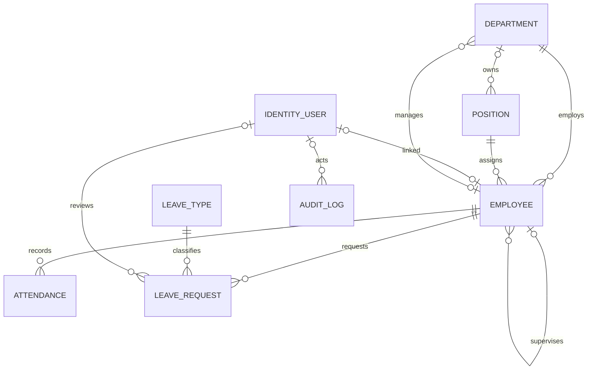

# Database design and migration safety

Restrict-delete foreign keys preserve relationships. Employee numbers remain reserved after soft deletion. Position codes have a unique SQL index and 50-character maximum. Employee and attendance rows now have SQL rowversion, alongside the existing leave rowversion. Employee edit requests carry the original token; stale or absent tokens return 409 rather than overwrite data. Attendance correction carries the original rowversion from the selected session. A stale or missing token cannot overwrite an existing session; use Edit beside that session. The general correction form adds missing records rather than silently choosing an existing interval.

`20261014110000_EnforceIntegrityAndConcurrency` adds these constraints and a filtered unique open-attendance index. Before upgrade it refuses duplicate position codes, codes over 50 characters and multiple open attendance records per employee. Resolve existing data through an authorized reviewed correction; the migration does not silently delete or rename data. Back up first. Existing applied migration SQL was preserved. The previous Designer metadata's accidental Position deletion fields were removed to reflect its original Up operation.

Use `dotnet ef migrations script --idempotent --project HRMS.Infrastructure --startup-project HRMS` for DBA review. Apply to a disposable SQL database before deployment. Snapshot/model consistency is tested without a SQL connection; that does not verify SQL execution. The current acceptance gate executes clean migrations and constraints on temporary SQL databases; HRMSnew was upgraded earlier. A production upgrade should still be rehearsed against a backup of that production dataset.

Arabic names are Unicode. Search uses SQL Contains; comparisons and sorting use the database collation, with no application-level removal of Arabic diacritics/tatweel or normalization of different Arabic letters. Choose/document an Arabic-capable collation before creating the production database; test actual organizational names. Do not change an existing collation automatically because unique comparisons can change.

The applied 20261015092148_LeaveTimesAndMultipleAttendanceSessions migration makes the employee/date index non-unique, preserves the filtered unique open-session index, and adds nullable leave StartTime/EndTime. The Application refactoring, profile and correction snapshot token require no additional schema migration. An idempotent delivery script is generated at artifacts/HRMS-net8-migrations.sql.
