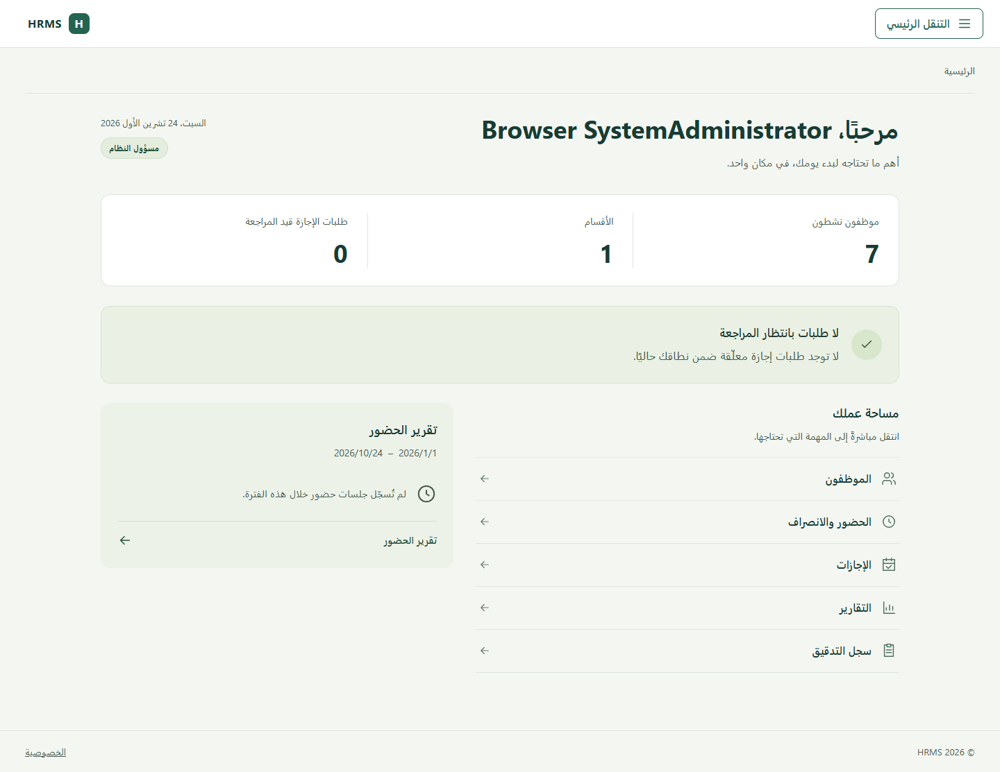
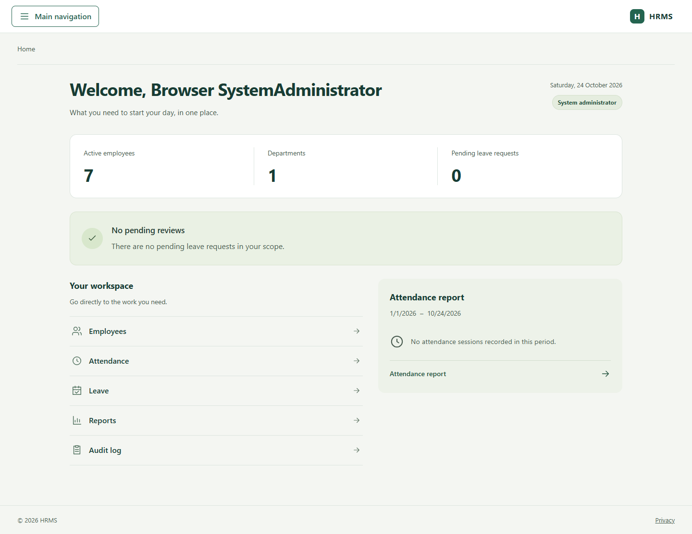
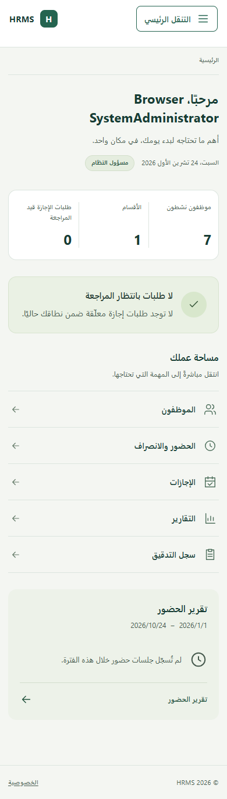
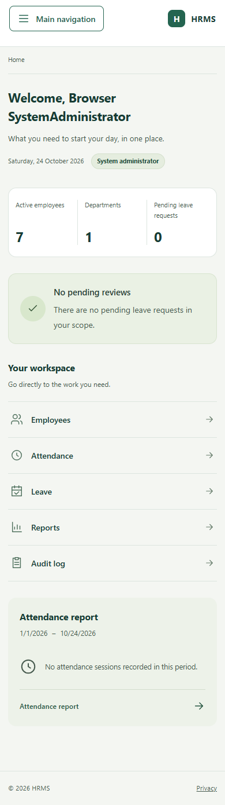
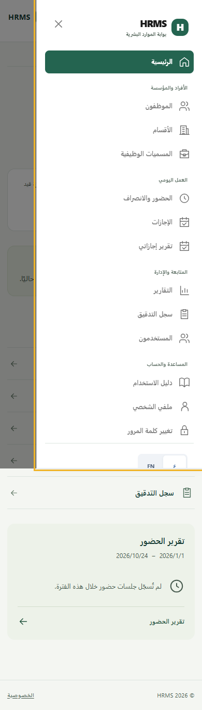

# مراجعة واجهة HRMS — 24 تشرين الأول 2026

المرحلة الأولى من تحسين لوحة التحكم والتنقل، على الفرع المؤقت `ui/hrms-polish-2026-10-24`.

## التغييرات

- وصول مباشر إلى مهام الموظفين والحضور والإجازات والتقارير والتدقيق بحسب صلاحيات الحساب الحالية.
- ملخص حضور يستخدم البيانات الموجودة في لوحة التحكم، مع عرض الفترة وتوجيه المستخدم إلى التقرير بالفترة نفسها. تظهر رسالة واضحة عند عدم وجود جلسات.
- حالة مستقلة لعدم وجود طلبات إجازة بانتظار المراجعة.
- عداد الموظفين النشطين يستخدم `TotalActiveEmployees` من ملخص التقارير.
- أيقونات SVG موحّدة، وتحديد الصفحة الحالية بقيمة `aria-current` من أول تحميل وبعد التنقل الداخلي.
- تصحيح التفاف محتوى القائمة على الشاشات الصغيرة، وتحسين المسافات وأحجام عناصر اللمس والمحاذاة في RTL وLTR.

## الحركة

فتح القائمة في 400ms وإغلاقها في 350ms. يظهر عنوان لوحة التحكم ومساحة المهام بحركة قصيرة مدتها 250ms ومسافة 8px، بفاصل 40ms. تبقى الأرقام ثابتة، وتتوقف الحركة عند تفعيل `prefers-reduced-motion`.

استُخدمت `impeccable` لتوجيه تحسين الواجهة الموجودة، و`make-interfaces-feel-better` للخطوط والمسافات والتركيز والأيقونات، و`transitions-dev` و`transitions-polish` لتناسق الحركة ومددها. التنفيذ يستخدم Razor وBootstrap وCSS الموجودة في المشروع.

## المعاينة

الصور من التطبيق الفعلي أثناء اختبارات Chrome بحسابات وبيانات اختبار معزولة.

| العربية — سطح المكتب | الإنجليزية — سطح المكتب |
| --- | --- |
|  |  |

| العربية — الموبايل | الإنجليزية — الموبايل | القائمة — الموبايل |
| --- | --- | --- |
|  |  |  |

## التحقق

- بناء Release ناجح بلا أخطاء أو تحذيرات.
- نجحت الاختبارات الـ103 دون فشل أو تخطٍّ قبل المراجعة البصرية الأخيرة.
- أعيد فحص المتصفح بعد المراجعة الأخيرة: الأدوار الستة، العربية والإنجليزية، عرضا 1440px و390px، صلاحيات اختصارات لوحة التحكم، وعدم وجود تمرير أفقي.
- يشمل فحص المتصفح تعطيل الحركة وفق تفضيل المستخدم، وإغلاق القائمة بزر Escape، وعودة التركيز إلى زر القائمة.
- لقطات سطح المكتب والموبايل راجعتها بصريًا. لم تُختبر هذه الجولة على Safari أو Firefox أو هاتف فعلي.
